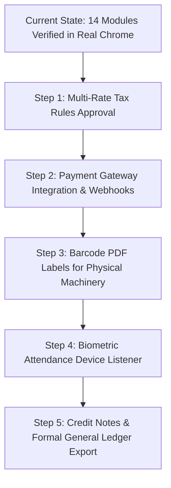

# KITCHEN BOTS — REMAINING WORK & ROADMAP

> **Status Date:** October 2026  
> **Source Base:** Main Dashboard & Storefront Workspaces  
> **Target Database:** PostgreSQL 16 (Local `kitchen_bots_test`)  
> **Current Build State:** `npm run check` passing (TypeScript + ESLint 0 errors). All 13 isolated Postgres integration tests passing.

---

## 1. Prioritized Work Backlog

| Priority | Feature / Area | Nature | Description & Acceptance Criteria | Risk & Dependencies |
| :---: | :--- | :--- | :--- | :--- |
| **P1** | **Multi-Rate Tax & Statutory Compliance** | Business Decision / Engine | Currently, `InvoicingEngine` computes a fixed 18% GST (CGST 9% + SGST 9% or IGST 18%). Need business confirmation if any equipment categories qualify for 12% or 5%, and implement tax category overrides on product level. | **Low Risk.** Must preserve historical line-item snapshots on already-issued invoices. |
| **P2** | **Payment Gateway Webhook Capture** | Integration | Implement automated inbound webhook handler for Razorpay / Cashfree / Stripe for automated reconciliation of credit card and UPI payments. | **Medium Risk.** Requires production API keys and webhook secret signing validation. Current manual bank reconciliation serves offline B2B wire transfers. |
| **P3** | **Biometric Attendance Hardware Bridge** | Hardware Integration | Create an MQTT or REST bridge to ingest clock-in punches from physical biometric terminals (ZKTeco / eSSL). | **Low Risk.** Attendance calculation and break deduction logic is already complete and verified in PostgreSQL. |
| **P4** | **Hardware Barcode / QR Label Generation** | Fulfillment / MES | Integrate printable SVG/PDF Code128 barcodes containing machine chassis serial numbers for factory floor tracking. | **Low Risk.** Work orders and stage transitions already exist. |
| **P5** | **Automated Credit Notes & Refunds** | Treasury / Accounting | Implement a formal `credit_notes` ledger linked to cancelled orders and partial equipment returns with tax reversal tracking. | **Medium Risk.** Must strictly adhere to double-entry accounting rules and maintain immutable audit records. |

---

## 2. Incomplete Functionality & Missing Integrations (Truthful Disclosures)

1. **Accounting Classification:**
   - The system is an operational stock movement ledger and transaction tracker, **not** a full statutory double-entry general ledger (no Chart of Accounts, debit/credit journal entries, or balance sheet generation).
2. **Payment Gateway Capture:**
   - Payments recorded in `PaymentsWorkspace` represent verified manual settlement methods (NEFT, RTGS, IMPS, Cheque, Cash). Automated gateway capture via webhooks is not yet connected to a live merchant account.
3. **Physical Hardware:**
   - Biometric punch clocks, handheld barcode scanners, and weigh-scale serial ports are software-ready via API, but operate with manual UI entry in the local development environment.

---

## 3. Recommended Implementation Order

